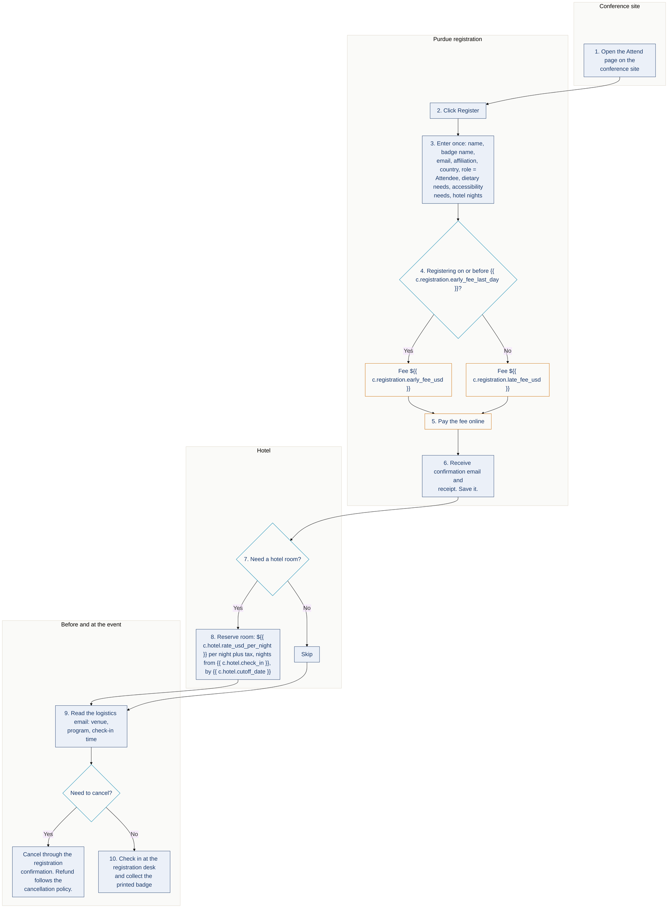

## Attendee path

For people attending without a paper or a session role.



## What you need and where it goes

| Step | Where | You enter or do | Link |
|---|---|---|---|
| 1 | Conference site | Open the Attend page | [{{ c.links.conference_site }}]({{ c.links.conference_site }}) |
| 2 to 5 | Purdue registration | Name, badge name, email, affiliation, country, role, dietary and accessibility needs, hotel nights; pay | {{ c.links.payment }} |
| 6 | Email | Keep the receipt | |
| 7 to 8 | Hotel | Reserve by {{ c.hotel.cutoff_date }}. Block code: {{ c.hotel.block_code }}. Method: {{ c.hotel.booking_method }} | {{ c.links.hotel_booking }} |
| 9 | Email | Read logistics | |
| 10 | Venue | Show your confirmation; collect your badge | |

## Cancellation policy ({{ c.registration.cancellation.status }})

- {{ c.registration.cancellation.full_refund }}: full refund
- {{ c.registration.cancellation.half_refund }}: 50% refund
- {{ c.registration.cancellation.no_refund }}: no refund
