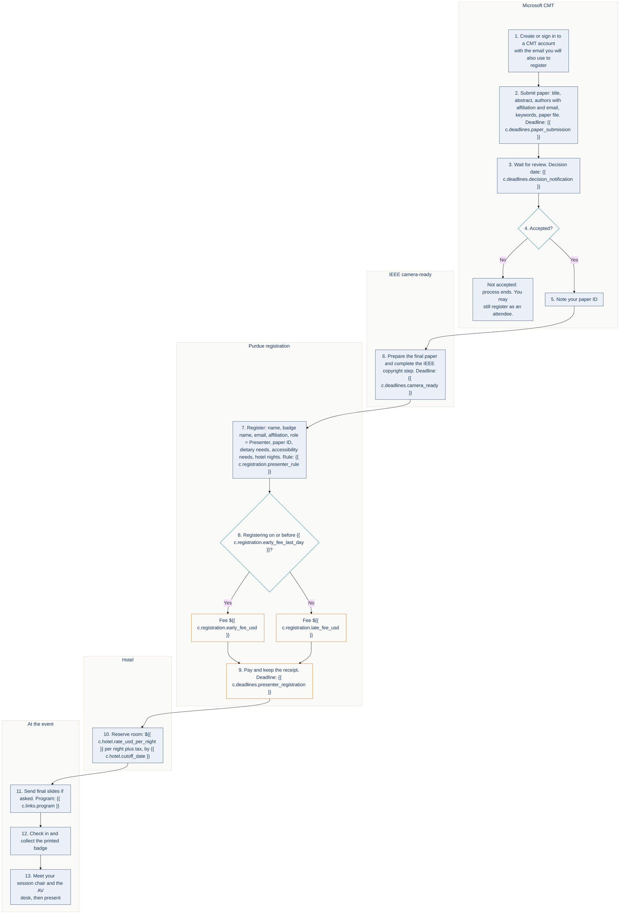

## Presenter path

For authors of an accepted paper. Your author details are entered once in CMT. At registration you add only your paper ID.



## What you need and where it goes

| Step | Where | You enter or do | Link |
|---|---|---|---|
| 1 to 3 | CMT | Account, then title, abstract, authors (name, affiliation, email), keywords, paper file | [CMT]({{ c.links.cmt }}) |
| 5 | CMT | Copy the paper ID | |
| 6 | IEEE | Final paper and copyright form | {{ c.links.ieee_camera_ready }} |
| 7 to 9 | Purdue registration | Same email as CMT, role, paper ID, badge name, needs, hotel nights; pay | {{ c.links.payment }} |
| 10 | Hotel | Reserve by {{ c.hotel.cutoff_date }}. Block code: {{ c.hotel.block_code }} | {{ c.links.hotel_booking }} |
| 11 to 13 | Venue | Slides, session chair, AV check, badge | |

## Open items for organizers

- Presenter registration rules (one registration per paper or per author, and any fee difference) are not decided: `PRESENTER_REGISTRATION_RULE_TBD`.
- All CMT dates and settings above are placeholders until you confirm them in CMT.
