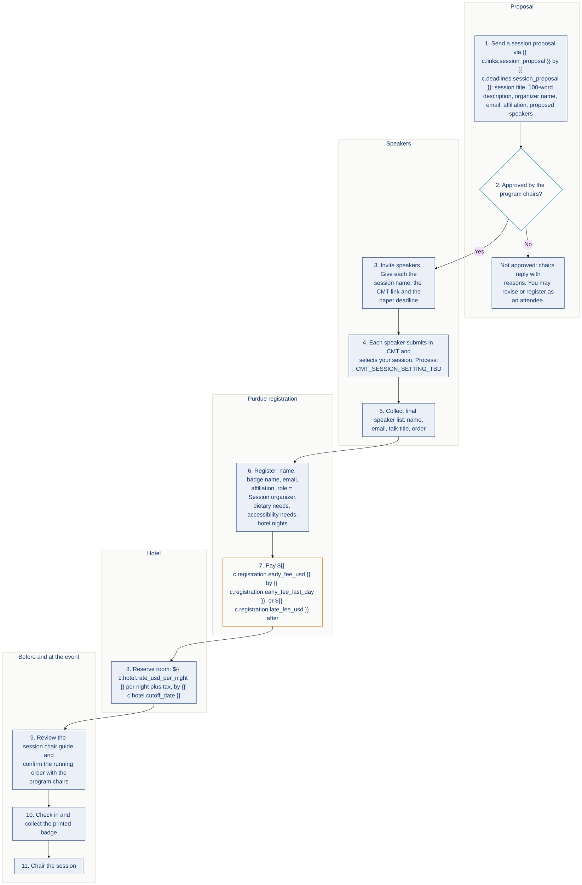

## Session organizer path

For people who propose and chair a session. This is a recommended flow. How sessions are proposed and approved is not yet decided, so those steps use placeholders.



## What you need and where it goes

| Step | Where | You enter or do |
|---|---|---|
| 1 to 2 | {{ c.links.session_proposal }} | Title, description, organizer details, proposed speakers |
| 3 to 5 | CMT and email | Speaker list; speakers submit in CMT ([CMT]({{ c.links.cmt }})) |
| 6 to 7 | Purdue registration | Same details as the attendee path, role = Session organizer; {{ c.links.payment }} |
| 8 | Hotel | Reserve by {{ c.hotel.cutoff_date }}. Block code: {{ c.hotel.block_code }} |
| 9 to 11 | Venue | See the [session chair guide](../../chairs/session-chairs/) |

## Open items for organizers

- Whether session organizers pay the standard fee: not decided.
- Whether CMT has a role or track for sessions: unverified. Do not rely on step 4 until checked.
